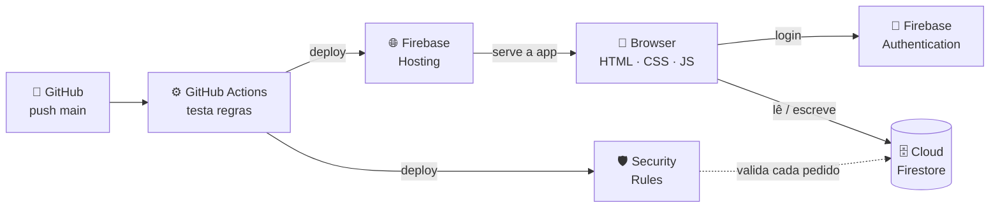
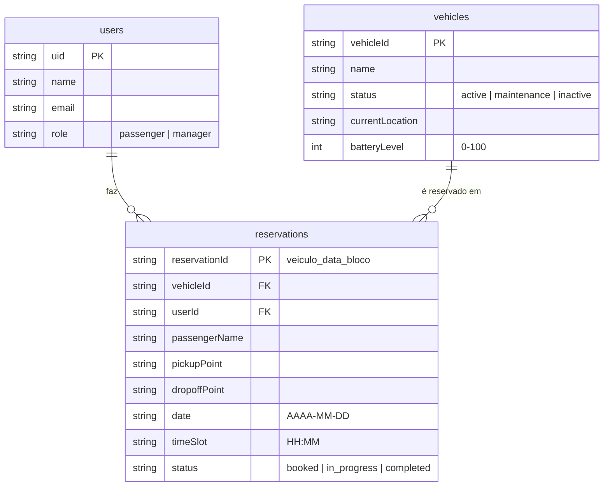

<div align="center">

# 🚕 RoboTaxi App

**Reservas de táxis autónomos num campus universitário, sem servidores próprios.**


🌐 **[cn-robottaxi.web.app](https://cn-robottaxi.web.app)** · Computação em Nuvem · ISLA Gaia · Grupo B

</div>

---

## 📌 Índice

1. [O que faz](#-o-que-faz)
2. [Arquitetura](#️-arquitetura)
3. [Arranque rápido](#-arranque-rápido)
4. [Segurança](#-segurança-firestore-security-rules)
5. [Modelo de dados](#️-modelo-de-dados)
6. [Deploy automático](#-deploy-automático-cicd)
7. [Configuração inicial](#-configuração-inicial-uma-vez-só)
8. [Estrutura do projeto](#-estrutura-do-projeto)

---

## ✨ O que faz

<table>
<tr>
<th width="50%">🧑 Passageiro</th>
<th width="50%">🛠️ Gestor de Frota</th>
</tr>
<tr valign="top">
<td>

- Vê a frota e o estado de cada veículo **em tempo real**
- Reserva uma viagem: recolha, destino, data e bloco de 30 min
- Vê a **grelha de ocupação** (Veículo × Bloco Horário)
- Consulta e cancela as suas reservas (enquanto não começaram)

</td>
<td>

- Adiciona e edita veículos (nome, localização, bateria)
- Muda o estado: **Ativo · Em Manutenção · Inativo**
- Vê a ocupação global e as viagens de cada dia
- Avança as viagens: **Reservada → Em curso → Concluída**

</td>
</tr>
</table>

> 💡 Tudo o que o gestor altera chega aos passageiros na hora, através de *listeners* do Firestore.

---

## 🏗️ Arquitetura

Modelo **BaaS** (Backend as a Service): o browser fala diretamente com o Firebase e as **Security Rules** fazem o papel do backend.



| Serviço | Para quê |
| --- | --- |
| 🌐 **Firebase Hosting** | Aloja a app num URL público |
| 🔑 **Authentication** | Login por e-mail/palavra-passe |
| 🗄️ **Cloud Firestore** | Utilizadores, veículos e reservas |
| 🛡️ **Security Rules** | Permissões por perfil e regras de negócio |
| ⚙️ **GitHub Actions** | Testa as regras e publica automaticamente |

---

## 🚀 Arranque rápido

> **Precisas de:** [Node.js 20+](https://nodejs.org) e [Java 11+](https://adoptium.net) (o emulador do Firestore corre em Java).

```bash
cd Project
npm ci          # 1. instalar dependências
npm test        # 2. testar as Security Rules
```

### Ver a app a funcionar localmente

Usa os **emuladores do Firebase**: nada toca nos dados reais.

```bash
npm run serve   # terminal 1 → emuladores Auth + Firestore + Hosting
npm run seed    # terminal 2 → cria 3 veículos e 2 contas de teste
```

Depois abre **http://localhost:5000** e entra com uma das contas de [`tests/seed.js`](tests/seed.js) (gestor ou passageiro).

| Comando | O que faz |
| --- | --- |
| `npm test` | Corre os 29 testes das Security Rules no emulador |
| `npm run serve` | Arranca os emuladores e serve a app em `localhost:5000` |
| `npm run seed` | Carrega dados de teste (com `serve` a correr) |

> ⚠️ Os dados dos emuladores desaparecem quando os paras. Corre `npm run seed` outra vez depois de reiniciar.

---

## 🛡️ Segurança (Firestore Security Rules)

As regras em [`firestore.rules`](firestore.rules) garantem as regras de negócio **no servidor**: mesmo que alguém altere o JavaScript no browser, não as contorna.

| Regra | Como é garantida |
| --- | --- |
| 🚫 **Sem reservas sobrepostas** | ID determinístico `veiculo_data_bloco` (ex.: `taxi_01_20261028_1430`) + `!exists()` |
| ⏱️ **Blocos de 30 min** | `timeSlot` só aceita `HH:00` ou `HH:30` |
| 📅 **Sem datas passadas** | A data tem de ser hoje ou futura |
| 🚗 **Só veículos ativos** | Reserva recusada se `status != 'active'` |
| 👤 **Cada um no seu nome** | `userId` = utilizador autenticado e `passengerName` = nome do perfil |
| ❌ **Cancelar só antes da viagem** | O passageiro só apaga reservas suas em estado `booked` |
| 👑 **Sem autopromoção** | O cliente nunca pode escrever `role: 'manager'` |
| 🗃️ **Remoção lógica** | Veículos nunca são apagados: passam a `inactive` |
| 🔒 **Só o gestor gere a frota** | Escrita em `vehicles` e mudança de estado das viagens restritas a `manager` |

### 🧪 Testes

Os [29 testes](tests/rules.test.js) correm no **Firebase Emulator** com `@firebase/rules-unit-testing` e cobrem cada regra acima, nos casos permitidos e nos casos recusados.

```text
✔ não há sobreposição: segundo passageiro no mesmo bloco falha
✔ utilizador não se autopromove a manager ao criar
✔ passageiro não cancela viagem já iniciada
✔ reserva com data passada é rejeitada
  … 29 testes, 0 falhas
```

---

## 🗄️ Modelo de dados



---

## 🔄 Deploy automático (CI/CD)

Cada **push para `main`** dispara o workflow [`.github/workflows/deploy.yml`](../.github/workflows/deploy.yml):

```text
push main ──► npm ci ──► npm test (29 testes) ──► firebase deploy (Hosting + Rules)
                              │
                              └── ❌ se algum teste falhar, nada é publicado
```

Os *pull requests* só correm os testes, não publicam.

---

## 🔧 Configuração inicial (uma vez só)

- [ ] **1. Criar a base de dados Firestore**
  Consola Firebase → projeto `cn-robottaxi` → Firestore Database → *Create database* (modo produção).

- [ ] **2. Criar o secret do CI**
  Google Cloud Console → IAM → *Service Accounts* → criar conta com o papel **Firebase Admin** → *Keys* → gerar chave JSON.
  No GitHub: *Settings → Secrets and variables → Actions* → novo secret **`FIREBASE_SERVICE_ACCOUNT`** com o conteúdo do JSON.
  > Se o deploy falhar por permissões, acrescenta também o papel **Service Usage Consumer**.

- [ ] **3. Criar o primeiro gestor**
  Cria uma conta normal na app → Consola Firestore → `users/{uid}` → muda `role` para `manager`.

---

## 📁 Estrutura do projeto

```text
Project/
├── 📄 firebase.json          ← configuração de Hosting, Firestore e emuladores
├── 🛡️ firestore.rules        ← Security Rules
├── 📦 package.json           ← scripts: test · serve · seed
├── 🌐 public/
│   ├── index.html            ← interface (passageiro + gestor)
│   └── app.js                ← lógica e ligação ao Firebase
└── 🧪 tests/
    ├── rules.test.js         ← 29 testes das Security Rules
    └── seed.js               ← dados de teste para os emuladores
```

---

<div align="center">

**Grupo B** · Gustavo Silva · Mikael Braun · Pedro Teixeira · Rúben Dias

</div>
